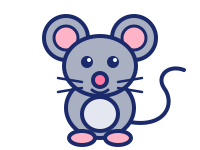
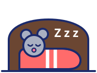
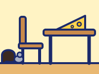
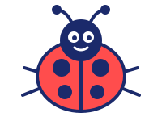
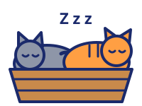
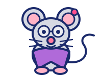

<!-- Pip wacht hungrig auf, hilft Kiki, klettert auf den Tisch und findet den Käse. Endet mit 3 Mut-Sternen. -->

# zuhause

Hallo! Ich bin Pip.
Ich bin eine kleine Maus.
Ich wohne in einem [Loch]{say "Das Loch ist klein. Genau richtig für mich!"} in der Wand.

Mein Bauch macht: *grrr*.
Ich habe so, so großen Hunger!

[[Aus dem Loch gucken -> gucken]]
[[Im Bett verstecken -> bett]]

# bett

Ich verstecke mich im Bett.
{if socke}
Mein Bett ist eine alte Socke.
{else}
Mein Bett ist eine alte [Socke]{get socke}.
{end}
Sie ist weich und warm.

Aber mein Bauch macht: **GRRR!**
So kann ich nicht schlafen.

[[Aus dem Loch gucken -> gucken]]

# gucken

Ich gucke aus dem Loch.
Da ist die große Küche.

Schnupper, schnupper ...
Ich rieche Käse!

Oh! Was ist das? Ist das eine Katze?
Nein. Das ist nur ein [Besen]{say "Nur ein alter Besen. Puh!"}.

[[Zurück ins Bett rennen -> bett]]
[[In die Küche gehen -> boden]]

# boden

Ich tippel los. Tipp, tapp, tipp, tapp.
Der Boden ist kalt an meinen Füßen.

Oben auf dem Tisch liegt der Käse.
Er ist groß und gelb.
Aber der Tisch ist so hoch!

{if not kruemel and not kiki_satt}
Guck mal! Ein [Krümel]{get kruemel} auf dem Boden.
{end}

[[Auf den Stuhl klettern -> stuhl | if mut >= 2]]
[[Unter der Spüle nachsehen -> spuele]]
[[Den Krümel essen -> essen | only kruemel]]

# essen

{lose kruemel}
Lecker! Ein Käsekrümel!
Aber er ist so klein.
Mein Bauch macht immer noch: *grrr*.

[[Zurück -> boden]]

# spuele

Unter der Spüle wohnt Kiki.
Kiki ist ein Marienkäfer.
Kiki ist rot mit schwarzen Punkten.
Kiki ist klein, so wie ich.

{if kiki_satt}
„Hallo, Pip!“, sagt Kiki.
„Danke für den Krümel!
Los, hol dir den Käse!“
{else}
„Hallo, Pip“, sagt Kiki.
„Ich habe so großen Hunger.“
„Ich auch!“, sage ich.

[[Kiki den Krümel geben -> geben | if kruemel]]
{end}
[[Zurück -> boden]]

# geben

{lose kruemel; set kiki_satt}
Ich gebe Kiki meinen Krümel.
Kiki freut sich so!
„Du bist lieb, Pip“, sagt Kiki.
„Und lieb sein ist mutig.“

Ich stehe ganz gerade.
Ich fühle mich ein bisschen mutiger! {mut +1}

[[Zurück zum Tisch -> boden]]

# stuhl

Ich klettere am Stuhlbein hoch.
Hoch, hoch, hoch!
Nicht runtergucken, Pip ...

Ups! Ich gucke runter.
Das ist SO hoch!

[[Festhalten und weiter -> tisch]]
[[Wieder runter -> boden]]

# tisch

Geschafft! Ich bin auf dem Tisch.
Und hier ist der Käse!
Er ist groß. Er ist gelb.
Er hat ganz viele Löcher.

{if not glocke}
Daneben liegt eine kleine [Glocke]{get glocke; say "Kling, kling!"}.
{end}

[[Den Käse essen -> knabbern]]

# knabbern

Knabber, knabber. Mmm, lecker!
Jetzt ist mein Bauch froh.

Dann gucke ich runter.
An der Tür steht ein Korb.
Im Korb liegen zwei [Katzen]{say "Schnarch ... Schnarch ..."}!
Sie schlafen.
Schluck.

[[Noch ein Stück essen -> mehr]]
[[Mit etwas Käse heim rennen -> rennen]]

# mehr

Nur noch ein Bissen ...
Und noch einer ...
Und noch einer ...

Oh nein! Mein Bauch ist so dick.
Ich bin rund wie ein Ball!

[[Nach Hause rollen -> rennen]]

# rennen

Ich rutsche den Stuhl runter. Huiii!
Ich renne zu meinem Loch.
Tipp, tapp, tipp, tapp.
Die Katzen wachen nicht auf. Puh!

[[Rein ins Loch -> oma]]

# oma

In meinem Loch sitzt Oma Maus.
Sie schnuppert. „Ist das Käse, Pip?“
„Ja!“, sage ich. „Den habe ich ganz allein geholt!“

Oma drückt mich ganz fest.
„Pip, du bist so mutig!“ {mut +1}

Dann sagt sie:
„Morgen habe ich Geburtstag.
Ich wünsche mir einen GROSSEN Käse.“

Der große Käse ist in der Speisekammer.
Und vor der Speisekammer ... schlafen die Katzen.

[[Ende von Kapitel eins -> @end]]
