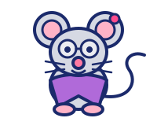
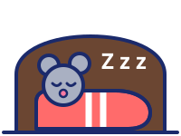
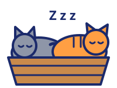
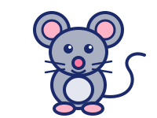

<!-- Pip holt den großen Käse für Omas Geburtstag, vorbei an den schlafenden Katzen.
     Vorbei kommt Pip mit mut >= 4 (vorher einmal zu Hause bleiben) oder hüpfend in der Socke.
     Mimi wacht auf: Glocke, verstecken oder Hallo sagen. -->

# start

Heute hat Oma Geburtstag!
Ich will ihr den GROSSEN Käse holen.

Der große Käse ist in der Speisekammer.
Aber vor der Speisekammer schlafen die Katzen.
Zwei große Katzen!

{if not socke}
Meine alte [Socke]{get socke} liegt auf dem Bett.
{end}

[[In die Küche gehen -> kueche]]
[[Zu Hause bleiben und verstecken -> bleiben]]

# bleiben

Ich verstecke mich im Bett.
Katzen sind groß. Katzen sind schnell.
Und ich bin so klein.

{if geblieben}
Aber ich will, dass Oma sich freut.
{else}
Aber dann denke ich an Oma.
Sie drückt mich. Sie singt mir was vor.
Ich will, dass sie sich freut.

Ich stehe auf. Ich schaffe das! {mut +1; set geblieben}
{end}

[[In die Küche gehen -> kueche]]

# kueche

Ich schleiche in die Küche.
Da sind sie, im Korb.
Ein grauer [Kater]{say "Das ist Brummel. Er schnarcht. Schnarch!"} und eine orange [Katze]{say "Das ist Mimi. Sie hat große Ohren!"}.

Die Speisekammer ist hinter den Katzen.
Ich darf sie nicht wecken!

[[An den Katzen vorbeigehen -> gehen | if mut >= 4]]
[[In der Socke vorbeihüpfen -> huepfen | if socke]]
[[Schnell nach Hause rennen -> bleiben]]

# gehen

Ich atme tief ein.
Ich gehe an den Katzen vorbei.
Tipp ... tapp ... tipp ... tapp ...

Mimis Schwanz wackelt!
Ich bleibe stehen. Ich bin ganz still.
Schnarch. Schnarch. Puh!

[[Zur Speisekammer gehen -> speisekammer]]

# huepfen

Ich steige in meine Socke.
Ich hüpfe, hüpfe, hüpfe.
Die Socke ist weich.
Man hört mich gar nicht!

Brummels Ohr zuckt ...
Aber er wacht nicht auf. Puh!

[[Zur Speisekammer hüpfen -> speisekammer]]

# speisekammer

Die Tür ist ein Stück offen.
Ich quetsche mich durch. Quetsch!

Da ist er. Der GROSSE Käse!
Er ist rund wie ein Rad.
Er ist so groß wie ich!

[[Den Käse schieben -> schieben]]

# schieben

{get grosser_kaese}
Ich schiebe und schiebe. Uff!
Der Käse rollt aus der Tür.
Roll, roll, roll ...

BUMM! Er stößt an einen Topf.
**KLONG!**

[[Oh nein! -> wach]]

# wach

Mimi macht ein Auge auf.
Dann macht sie zwei Augen auf.
„Miau?“

Mimi ist wach!
Meine Beine zittern. Was mache ich nur?

[[Die Glocke wegrollen -> glocke | if glocke]]
[[Im Käseloch verstecken -> verstecken]]
[[Hallo zu Mimi sagen -> hallo | if mut >= 3]]

# glocke

{lose glocke}
Ich rolle die Glocke über den Boden.
Kling, kling, kling!

Mimi sieht die Glocke.
Sie springt drauf. Hopp!
Sie stupst sie. Sie jagt sie.
Mich hat sie ganz vergessen!

[[Den Käse heimrollen -> heim]]

# verstecken

Ich springe in ein großes Käseloch.
Ich mache mich ganz klein.

Mimi kommt. Schnupper, schnupper.
„Hm. Nur Käse“, gähnt sie.
Sie legt sich wieder hin.

Ich habe nicht mal gepiepst! {mut +1}

[[Den Käse heimrollen -> heim]]

# hallo

Meine Beine zittern. Aber ich stehe ganz gerade.
„Hallo, Mimi“, sage ich.

Mimi blinzelt.
„Hallo, kleine Maus. Ist das Käse?“
„Der ist für meine Oma“, sage ich.
„Sie hat heute Geburtstag.“

Mimi schnurrt. „Dann lauf!
Ich sage Brummel nichts.“
{mut +1; set katzenfreundin}

[[Den Käse heimrollen -> heim]]

# heim

Ich rolle den Käse nach Hause.
Roll, roll, roll!
Er passt genau in mein Loch. Plopp!

[[Rein ins Loch -> feier]]

# feier

„Alles Gute zum Geburtstag, Oma!“
{lose grosser_kaese}
Oma klatscht. „Der GROSSE Käse!
Pip, du bist SO mutig!“

{if katzenfreundin}
„Und ich habe eine neue Freundin“, sage ich.
„Eine Katze!“
Oma macht große Augen. „Eine KATZE?“
{end}

Wir essen Käse. Wir singen.
Oma bekommt einen großen Käse,
und ich bekomme eine dicke Umarmung.

Ich bin immer noch eine kleine Maus.
Aber jetzt bin ich eine mutige kleine Maus.

[[Ende -> @end]]
