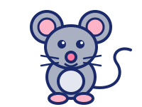
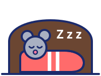
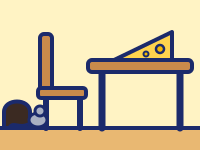
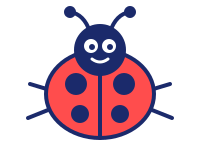
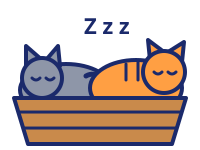
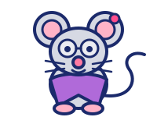

<!-- Pip wakes up hungry, helps Bug, climbs the table and finds the cheese. Ends at 3 brave stars. -->

# home

Hi! I am Pip.
I am a little mouse.
I live in a [hole]{say "It is a small hole. Just right for me!"} in the wall.

My tummy says: *grrr*.
I am so, so hungry!

[[Peek out of the hole -> peek]]
[[Hide in my bed -> bed]]

# bed

I hide in my bed.
{if sock}
My bed is an old sock.
{else}
My bed is an old [sock]{get sock}.
{end}
It is soft and warm.

But my tummy says: **GRRR!**
I can not sleep like this.

[[Peek out of the hole -> peek]]

# peek

I peek out of the hole.
I see the big kitchen.

Sniff, sniff...
I smell cheese!

Oh! What is that? Is it a cat?
No. It is just a [mop]{say "Just an old mop. Phew!"}.

[[Run back to bed -> bed]]
[[Go into the kitchen -> floor]]

# floor

I tiptoe out. Tip, tap, tip, tap.
The floor is cold on my feet.

Up on the table is the cheese.
It is big and yellow.
But the table is so high!

{if not crumb and not fed_bug}
Look! A [crumb]{get crumb} on the floor.
{end}

[[Climb up the chair -> chair | if brave >= 2]]
[[Look under the sink -> sink]]
[[Eat the crumb -> eat | only crumb]]

# eat

{lose crumb}
Yum! A crumb of cheese!
But it is so small.
My tummy still says: *grrr*.

[[Go back -> floor]]

# sink

Under the sink lives Bug.
Bug is red with black dots.
Bug is small, like me.

{if fed_bug}
"Hi, Pip!" says Bug.
"Thank you for the crumb!
Go on. Get that cheese!"
{else}
"Hi, Pip," says Bug.
"I am so hungry."
"Me too!" I say.

[[Give Bug the crumb -> give | if crumb]]
{end}
[[Go back -> floor]]

# give

{lose crumb; set fed_bug}
I give Bug my crumb.
Bug is so happy!
"You are kind, Pip," says Bug.
"And kind is brave."

I stand up tall.
I feel a bit braver! {brave +1}

[[Go back to the table -> floor]]

# chair

I climb up the chair leg.
Up, up, up!
Do not look down, Pip...

Oops! I look down.
It is SO far!

[[Hold on and climb -> table]]
[[Go back down -> floor]]

# table

I did it! I am on the table.
And here is the cheese!
It is big. It is yellow.
It has lots of holes.

{if not bell}
Next to it is a little [bell]{get bell; say "Ding, ding!"}.
{end}

[[Eat the cheese -> nibble]]

# nibble

Nibble, nibble. Yum, yum, yum!
My tummy is happy now.

Then I look down.
By the door is a basket.
In the basket are two [cats]{say "Zzz... Zzz..."}!
They are asleep.
Gulp.

[[Eat one more bite -> more]]
[[Run home with a bit of cheese -> run]]

# more

Just one more bite...
And one more...
And one more...

Oh no! My tummy is so big now.
I am like a little ball!

[[Roll home -> run]]

# run

I slide down the chair. Whee!
I run to my hole.
Tip, tap, tip, tap.
The cats do not wake up. Phew!

[[Go in -> grandma]]

# grandma

In my hole is Grandma Mouse.
She sniffs. "Is that cheese, Pip?"
"Yes!" I say. "I got it all by myself!"

Grandma gives me a big hug.
"Pip, you are so brave!" {brave +1}

Then she says:
"Tomorrow is my birthday.
I wish I had a BIG cheese."

The big cheese is in the pantry.
And by the pantry... sleep the cats.

[[The end of chapter one -> @end]]
