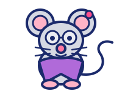
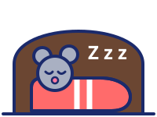
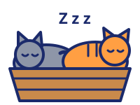
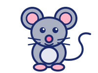

<!-- Pip gets the big cheese past the sleeping cats for Grandma's birthday.
     Ways past: brave >= 4 (stay home once first), or hop in the sock. Ginger wakes up: bell, hide or say hi. -->

# start

Today is Grandma's birthday!
I want to get her the BIG cheese.

The big cheese is in the pantry.
But by the pantry sleep the cats.
Two big cats!

{if not sock}
My old [sock]{get sock} is on my bed.
{end}

[[Go to the kitchen -> kitchen]]
[[Stay home and hide -> stay]]

# stay

I hide in my bed.
Cats are big. Cats are fast.
And I am so small.

{if stayed}
But I want Grandma to be happy.
{else}
But then I think of Grandma.
She hugs me. She sings to me.
I want her to be happy.

I get up. I can do this! {brave +1; set stayed}
{end}

[[Go to the kitchen -> kitchen]]

# kitchen

I tiptoe into the kitchen.
There they are, in the basket.
A gray [cat]{say "That is Smoky. He snores. Zzz!"} and an orange [cat]{say "That is Ginger. She has big ears!"}.

The pantry is past the cats.
I must not wake them up!

[[Walk past the cats -> walk | if brave >= 4]]
[[Hop past in my sock -> hop | if sock]]
[[Run back home -> stay]]

# walk

I take a big breath.
I walk past the cats.
Tip... tap... tip... tap...

Ginger's tail swishes!
I stop. I do not move.
Zzz. Zzz. Phew!

[[Go to the pantry -> pantry]]

# hop

I get in my sock.
I hop, hop, hop.
The sock is soft.
My hops make no sound at all!

Smoky's ear twitches...
But he does not wake up. Phew!

[[Hop to the pantry -> pantry]]

# pantry

The pantry door is open a bit.
I squeeze in. Squish!

There it is. The BIG cheese!
It is round like a wheel.
It is as big as me!

[[Push the cheese -> push]]

# push

{get big_cheese}
I push and push. Oof!
The cheese rolls out the door.
Roll, roll, roll...

BUMP! It hits a pan.
**CLANG!**

[[Oh no! -> wake]]

# wake

Ginger opens one eye.
Then she opens two eyes.
"Meow?"

Ginger is awake!
My legs shake. What do I do?

[[Roll the bell away -> bell | if bell]]
[[Hide in a cheese hole -> hide]]
[[Say hi to Ginger -> hello | if brave >= 3]]

# bell

{lose bell}
I roll the bell across the floor.
Ding, ding, ding!

Ginger sees the bell.
She jumps on it. Pounce!
She bats it. She chases it.
She forgot all about me!

[[Roll the cheese home -> home]]

# hide

I jump into a big cheese hole.
I make myself very small.

Ginger comes. Sniff, sniff.
"Hmm. Just cheese," she yawns.
She goes back to bed.

I did not even squeak! {brave +1}

[[Roll the cheese home -> home]]

# hello

My legs shake. But I stand up tall.
"Hi, Ginger," I say.

Ginger blinks.
"Hi, little mouse. Is that cheese?"
"It is for my Grandma," I say.
"It is her birthday."

Ginger purrs. "Then go!
I will not tell Smoky."
{brave +1; set cat_friend}

[[Roll the cheese home -> home]]

# home

I roll the cheese home.
Roll, roll, roll!
It just fits in my hole. Pop!

[[Go in -> party]]

# party

"Happy birthday, Grandma!"
{lose big_cheese}
Grandma claps. "The BIG cheese!
Pip, you are SO brave!"

{if cat_friend}
"And I have a new friend," I say.
"A cat friend!"
Grandma's eyes get big. "A CAT?"
{end}

We eat cheese. We sing.
Grandma gets a big cheese,
and I get a big hug.

I am still a little mouse.
But now I am a brave little mouse.

[[The end -> @end]]
